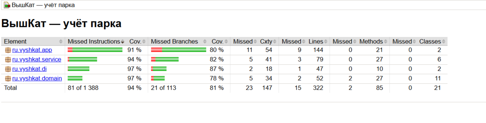

# ВышКат — консольный учёт парка

Учебный Java-проект по КПО (ДЗ №1): доменная модель инвентаря, техосмотр перед приёмкой,
отчёты, собственный DI-контейнер и unit-тесты. Слоган — «Доедем до дедлайна».

## Требования

- JDK 17 или новее.
- Maven 3.9+ — для тестов и отчёта покрытия.
- Без Maven приложение можно запустить скриптами `run.bat` (Windows) / `run.sh` (Linux/macOS); нужен только JDK.

## Запуск

### Интерактивный режим

```bash
mvn clean package
mvn exec:java
```

или без Maven: `run.bat` / `./run.sh` (на Windows `run.bat` сначала вызывает `build.bat`, который компилирует
проект только через `javac`). Выйти из программы штатно — пункт `0`.

Приложение показывает меню и читает команды со стандартного ввода:

| Пункт | Действие |
|---|---|
| 1 | Принять транспорт (запрашиваются тип, номер, простота 1–10, состояние, при необходимости энергия) — с техосмотром |
| 2 | Добавить вещь на баланс (шлем, зарядная станция, зарядный шкаф) |
| 3 | Отчёт: число единиц (всего / транспорт / вещи / по видам) и суммарная суточная энергия |
| 4 | Транспорт, подходящий новичкам |
| 5 | Весь инвентарь: наименования и инвентарные номера |
| 6 | Только прокатный транспорт |
| 0 | Выход |

Если ввод закончился (EOF, Ctrl+D / Ctrl+Z), приложение корректно завершается.
Кодировку вывода определяет консоль. `run.bat`/`demo.bat` сами выполняют `chcp 65001` и запускают JVM с
UTF-8. Если запускаете `mvn exec:java` в Windows PowerShell/cmd напрямую, сначала выполните `chcp 65001`,
иначе кириллица отобразится искажённо (это только отображение, на работу программы не влияет).
Лишний BOM в начале входного текста (его добавляет, например, `Get-Content | ...` в PowerShell) игнорируется.

### Повторяемая демонстрация (ввод из файла)

Данные для демонстрации **не зашиты в Java-код**: они лежат в `examples/demo-input.txt` и подаются
на стандартный ввод того же интерактивного `Main`.

```bash
./demo.sh            # Linux/macOS
demo.bat             # Windows
# или, в cmd / bash (в PowerShell оператор `<` не работает):
mvn -Dvyshkat.echoInput=true clean compile exec:java < examples/demo-input.txt
```

Параметр `-Dvyshkat.echoInput=true` печатает прочитанные строки, чтобы прогон из файла читался как диалог.
Сценарий (`examples/README.md`) показывает: отчёты на пустом парке; все виды ошибок ввода; приём исправного
транспорта; отказ техосмотра; вещи; дубликат номера (в т.ч. отличающийся регистром); итоговые отчёты.

Фрагмент вывода:

```text
[УСПЕХ] Транспорт VK-S-001 принят. Техосмотр пройден
[ОТКЛОНЕНО] Транспорт VK-S-003 не принят. Отклонено техосмотром: требуется ремонт
[ОТКЛОНЕНО] Отклонено: инвентарный номер VK-S-001 уже используется
--- Отчёт по парку ---
Всего инвентарных единиц: 7
Прокатного транспорта: 4
Вещей на балансе: 3
Суточное энергопотребление: 5.70 кВт·ч
По видам:
  Электросамокат: 2
  Велосипед: 1
  ...
--- Транспорт для новичков (простота ≥ 6) ---
Электросамокат [VK-S-001], простота: 8/10
Велосипед [VK-B-001], простота: 7/10
Электровелосипед [VK-EB-001], простота: 6/10
```

### Тесты и покрытие

```bash
mvn clean verify        # или test.bat / ./test.sh
```

JaCoCo строит отчёт `target/site/jacoco/index.html`, а `verify` падает, если покрытие инструкций ниже 60%.
Результат моего запуска `mvn clean verify` (отчёт JaCoCo): покрытие инструкций 94%, ветвей 81%
при пороге 60% в сборке.



## Модель и границы ответственности

```text
InventoryItem
├── RentalVehicle                    (default isBeginnerFriendly(): простота ≥ 6)
│   └── AbstractRentalVehicle
│       ├── Scooter                  + EnergyConsumer
│       ├── Bicycle
│       └── ElectricBicycle          + EnergyConsumer
└── ParkEquipment
    ├── Helmet
    ├── ChargingStation              + EnergyConsumer
    └── ChargingCabinet              + EnergyConsumer

ParkService ──> ServiceCenter (interface) <── DefaultServiceCenter
     └──────────> ParkRegistry <────────────── ParkReportService
ConsoleApplication ──> ParkService + ParkReportService
```

Пакеты: `domain` (сущности и роли), `service` (сценарии, отчёты, техосмотр), `di` (контейнер и
Composition Root), `app` (консольный адаптер).

- `InventoryItem` — контракт любого объекта на балансе: наименование и уникальный инвентарный номер.
- `EnergyConsumer` — отдельная роль для активов с суточным расходом (кВт·ч). Обычный велосипед и шлем её
  не реализуют, поэтому в модели нет «фальшивых нулей».
- `RentalVehicle` — прокатный транспорт: простота для новичка (1–10) и техническое состояние.
  Правило «для новичков» (`beginnerEase >= 6`, граница включительная) лежит в самом интерфейсе
  (`MIN_BEGINNER_EASE`, `isBeginnerFriendly()`): оно меняется там, где определены данные, а меню берёт
  порог из той же константы.
- `ParkEquipment` — вещи на балансе, не являющиеся прокатным транспортом.
- Сотрудники в модель не входят: на баланс ставятся только транспорт и вещи. Заготовок «на вырост» нет (YAGNI).
- `ParkRegistry` хранит активы в порядке регистрации, наружу отдаёт неизменяемые копии; регистрация
  package-private — изменения идут через `ParkService`.
- `ParkService` — изменения парка: проверка уникальности номера → техосмотр → регистрация.
- `ParkReportService` — только чтение: подсчёты, энергия, список для новичков.
- `ConsoleApplication` — консольный адаптер: ввод, разбор, вывод. Бизнес-правил в нём нет, но он создаёт
  конкретные объекты по выбору пользователя (см. раздел про OCP). Так интерфейс отделён от логики:
  `ParkService` и `ParkReportService` ничего не знают о консоли и годятся для файлового или веб-интерфейса.

### Почему `Scooter` и `ElectricBicycle` (а также `ChargingStation` и `ChargingCabinet`) — отдельные классы

Они почти одинаковы по полям, но это разные виды активов с разными наименованиями и, в будущем, разными
правилами (скорость, тип батареи, ёмкость шкафа). Общую базу ради двух строк с полем энергии я не вводил:
она связала бы разные иерархии (транспорт и вещи) и не дала бы выгоды. Если появятся ещё потребители с
одинаковым поведением, общую часть стоит вынести.

## Правила предметной области

1. Инвентарный номер обязателен и уникален среди **всех** объектов на балансе. Он нормализуется единым правилом `InventoryItem.normalize` (его же использует поиск `ParkRegistry.findByInventoryNumber`)
   (пробелы по краям убираются, регистр приводится к верхнему): `vk-h-1` и `VK-H-1` — один и тот же номер.
2. В активный парк попадает только транспорт, прошедший техосмотр. `DefaultServiceCenter` отклоняет
   транспорт с `TechnicalCondition.NEEDS_REPAIR`. Вещи техосмотру не подлежат.
3. Для новичков подходит прокатный транспорт с простотой ≥ 6.
4. Суммарное энергопотребление — сумма по всем зарегистрированным `EnergyConsumer`, включая зарядную
   инфраструктуру: отчёт отражает потребление всего учтённого парка.
5. Энергия — конечное неотрицательное число. Суммирование в `double`; для нормативных расчётов
   единицы и округление пришлось бы формализовать отдельно.

## SOLID и простота дизайна

### S — Single Responsibility
Приём активов (`ParkService`), отчёты (`ParkReportService`), политика допуска (`DefaultServiceCenter`),
хранение (`ParkRegistry`), ввод/вывод (`ConsoleApplication`) разделены. Изменение формата отчёта не
затрагивает техосмотр.

### O — Open/Closed
`ParkService` и `ParkReportService` работают с `RentalVehicle`, `InventoryItem`, `EnergyConsumer`, а не с
конкретными классами. Новый вид транспорта участвует в приёмке и отчётах без правки сервисов. Ограничение
описано ниже, в разделе обязательных вопросов.

### L — Liskov Substitution
Любой наследник `AbstractRentalVehicle` можно подставить вместо `RentalVehicle`: номер, простота 1–10 и
состояние гарантированы базовым классом и неизменяемы (`final`-методы). Подклассы не ослабляют
валидацию и не бросают новых исключений в геттерах.

### I — Interface Segregation
Роли узкие: `InventoryItem`, `EnergyConsumer`, `RentalVehicle`, `ParkEquipment`. Шлему не нужен
`dailyEnergyKwh()`, велосипеду — тоже.

### D — Dependency Inversion
`ParkService` получает `ServiceCenter` через конструктор и не знает о `DefaultServiceCenter`. Выбор
реализаций сосредоточен в `ApplicationWiring`.

### DI-контейнер
`ServiceContainer` — небольшой собственный контейнер (без фреймворков): регистрация фабрик, ленивые
singleton-объекты, обнаружение циклических зависимостей, `override` для подмены. Используется только в
Composition Root (`ApplicationWiring`, `Main`); доменные классы и сервисы о контейнере не знают.
Фабрики-лямбды сами запрашивают зависимости у контейнера — автосвязывания через reflection нет, это
сознательное упрощение. `override` разрешён только до первого `get`: после создания часть графа уже
держит старый экземпляр, и тихая замена дала бы несогласованное состояние. Для подмены в тестах граф
собирается через `ApplicationWiring.registerDefaults`, затем заменяется одна зависимость.

### Где сознательно не добавлял абстракции
- Нет общей иерархии с «энергопотреблением» у всех активов — для этого есть роль `EnergyConsumer`.
- Нет фабрик и билдеров под каждый класс транспорта.
- Нет паттерна State для техосмотра: достаточно `TechnicalCondition` и решения `ServiceCenter`.
- Нет интерфейса над `ParkRegistry`: одна in-memory реализация, вторая пока не нужна.
- Нет базы данных, сотрудников, станций аренды и склада — это будущие направления, а не текущие требования.

## Обязательные вопросы задания

### Какой принцип SOLID применён наиболее явно и где?
**DIP** — в `ParkService`: сервис принимает `ServiceCenter` в конструкторе и не создаёт
`DefaultServiceCenter` сам. Приём транспорта не зависит от конкретного алгоритма техосмотра, и его можно
подменить в тестах (`ParkServiceTest`, `ServiceCenterSubstitutionTest`). Сборка графа — в `ApplicationWiring`.

### Какой принцип сознательно ограничен / «почти нарушен» и почему это приемлемо?
**OCP** — на уровне консольного ввода. `ConsoleApplication.addVehicle()` содержит `switch`, который
превращает пункт меню в конкретный класс (`Scooter`, `Bicycle`, `ElectricBicycle`), и так же устроен
`addEquipment()`. Для нового вида транспорта нужно добавить пункт меню и ветку `switch`. Это приемлемо:
правки локальны и касаются только пользовательского интерфейса, а правила приёмки, расчёт энергии и отбор
новичков не меняются. Динамический каталог типов (регистрация через конфигурацию/рефлексию) для трёх видов
транспорта был бы избыточен. Если появится второй интерфейс (файл, веб), создание объектов стоит вынести из
консольного класса в общую фабрику — этот шаг пока не оправдан.

### Что сломается (или не сломается) при добавлении нового вида транспорта, сотрудника, склада?
- **Новый транспорт** (например, `CargoBicycle`): наследуем `AbstractRentalVehicle`, при расходе энергии
  добавляем `EnergyConsumer`. `ParkService`, `ParkReportService`, `ParkRegistry`, `ServiceCenter` не
  меняются; сломается только то, что пользователь не сможет создать этот тип, пока не добавлен пункт меню
  и ветка `switch` в `ConsoleApplication`.
- **Сотрудник:** отдельная модель и сервис кадрового учёта. Не реализует `InventoryItem` — значит, не попадает
  в инвентарь и отчёт по энергии; существующий код не меняется.
- **Склад запчастей:** если запчасть — актив с номером, она реализует `InventoryItem`/`ParkEquipment` и сразу
  попадает в инвентарь (это проверяет `ParkReportServiceTest.equipmentCountIgnoresInventoryItemsThatAreNeitherVehiclesNorEquipment`).
  Расходные материалы с количеством требуют отдельной модели учёта и списания.

### Какой тест фиксирует техосмотр / правило «для новичков» и как подменяется зависимость?
- `ParkServiceTest.registersVehicleOnlyWhenInjectedInspectionPasses` и `rejectsVehicleWhenInjectedInspectionFails` —
  в `ParkService` через конструктор передаётся `FakeServiceCenter` с заданным решением; регистрация
  зависит только от него, а не от состояния транспорта.
- `ServiceCenterSubstitutionTest` — подмена **через контейнер**: `ApplicationWiring.registerDefaults` +
  `ServiceContainer.override(ServiceCenter.class, () -> fake)`. Fake «отказать всем» не пускает исправный
  велосипед, fake «принять всех» пускает велосипед с `NEEDS_REPAIR`.
- `ParkServiceTest.defaultServiceCenterRejectsVehicleMarkedForRepair` — реальная политика `DefaultServiceCenter`.
- `ParkReportServiceTest.beginnerThresholdIsInclusiveAndOnlyAppliesToRentalVehicles` и
  `DomainValidationTest.beginnerRuleIsInclusiveAtThreshold` — порог `>= 6`.
- `ParkServiceTest.*InventoryNumber*` и `ParkReportServiceTest.inventoryNumbersDifferingOnlyByCaseAreDuplicates` —
  уникальность номеров между транспортом и вещами; для дубликата техосмотр не вызывается.

### Что сделал ИИ, а что изменил я?

ИИ-ассистент (Claude) использовался как инструмент: черновики кода и тестов, помощь с консольным
вводом/выводом, ревью и правки по замечаниям к ТЗ.

**Что сделал ИИ**
- Каркас консольного меню, разбор ввода (`readLine`/`readInt`/`readDouble`, EOF посреди формы,
  строгий разбор чисел, игнорирование BOM) и обработка ошибок ввода.
- Черновики доменных классов и интерфейсов (`InventoryItem`, `EnergyConsumer`), черновики README.
- Правки после проверки на соответствие ТЗ: нормализация инвентарных номеров (в т.ч. при поиске
  в `ParkRegistry`), правило «для новичков» в `RentalVehicle`, отчёт по видам, новые тесты на эти
  изменения (BOM, `1d`, пустой парк, регистр номера, `countByName`, `findByInventoryNumber`).
- Исправление проблем, найденных мной при запуске на Windows (подробнее ниже):
  - демо-данные в коде (`DemoMain`) заменены вводом из файла `examples/demo-input.txt` через
    тот же интерактивный `Main`;
  - `demo.bat` не читал ввод из файла: сборка вынесена в `build.bat`, а перенаправление
    ввода применяется только к команде `java`;
  - `run.bat` не собирал проект из-за обратных слэшей в `@argfile`: компиляция через `-sourcepath`;
  - искажение кириллицы в консоли и лишний BOM в начале ввода из PowerShell: вывод подстраивается
    под консоль, BOM игнорируется.
- Ревью: замечания по `ServiceContainer` и `ConsoleApplication`; правки вносились мной.

**Что сделал я**
- Архитектура и слои `domain` / `service` / `di` / `app`; распределение ответственности
  (`ParkService` — изменения, `ParkReportService` — чтение, `ParkRegistry` — хранение,
  `ConsoleApplication` — ввод/вывод).
- DI: `ServiceContainer`, `ApplicationWiring`, ленивые singleton, запрет `override` после
  первого `get`, обнаружение циклов.
- Правила предметной области: порядок «уникальность номера → техосмотр → регистрация»,
  граница «для новичков» `>= 6`, суммирование энергии только по `EnergyConsumer`.
- Дизайн-компромиссы (OCP в `ConsoleApplication`, отдельные классы `Scooter` и `ElectricBicycle`,
  отказ от паттерна State для техосмотра) и их обоснование в README.
- Тесты: приёмка и отказы, подмена `ServiceCenter` через конструктор и через контейнер
  (`ParkServiceTest`, `ServiceCenterSubstitutionTest`), отчёты, `ApplicationWiringTest`.
- Запуск и проверка проекта на Windows (Maven, PowerShell, `run.bat`, `demo.bat`): сборка,
  тесты, ручной и файловый сценарии. Найденные проблемы (остаточный `DemoMain.java` с демо-данными
  в коде, `demo.bat` не читал ввод, кодировка и BOM) передавал ИИ на исправление и повторно
  проверял результат.

## Тесты

JUnit 5, 44 теста. Они проверяют:

- приёмку транспорта только после положительного решения подменённого `ServiceCenter` и отказ при отрицательном;
- реальную политику `DefaultServiceCenter`;
- уникальность номеров (транспорт/вещи в обе стороны, регистр, повторный техосмотр не вызывается);
- вещи без техосмотра транспорта;
- сумму энергии только по `EnergyConsumer`; число единиц по видам; `equipmentCount` игнорирует прочие активы;
- включительную границу «для новичков»;
- валидацию простоты, номера и энергии, нормализацию номера;
- консоль: добавление и отчёты, отказ техосмотра, неизвестный тип/пункт меню, не-число, `1d` в энергии,
  пустой и невалидный ввод до следующего вопроса, EOF посреди формы, отчёты на пустом парке;
- `Main` (запуск и выход); игнорирование BOM во входном тексте;
- DI-контейнер: ленивый singleton, дубликат регистрации, `override` до и после `get`, циклические
  зависимости, сборка графа, подмена `ServiceCenter` через контейнер.
